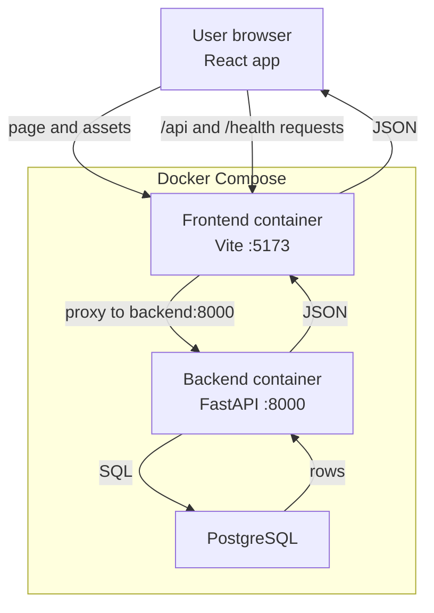

# Developer Guide

This document is for developers who have not seen the project before. It describes the **current** local app: a weekly fridge temperature report, not live monitoring and not a cloud deployment.

Start the stack with [README.md](../README.md). Design decisions and limitations are in [NOTES.md](../NOTES.md).

## 1. Architecture overview

Docker Compose runs three services: the Vite frontend (`:5173`), the FastAPI backend (`:8000`), and PostgreSQL.

The browser loads the React app from Vite. Frontend `fetch` calls use same-origin paths `/api/...` and `/health`. Vite’s dev server proxies those paths to the backend container (`http://backend:8000`). The backend reads and writes PostgreSQL.



Verified in `docker-compose.yml` and `frontend/vite.config.ts` (`/api` and `/health` proxy to `http://backend:8000`). API routes live on the backend under `/api` (`backend/app/routers/api.py`). Health is `/health` (`backend/app/routers/health.py`).

## 2. How data flows

### A. Importing temperature data

```text
Excel file
  -> Review (dry run)
  -> Validation / normalization
  -> Confirm logger and fridge assignments (and historical source units)
  -> Import
  -> PostgreSQL
```

- **Initial Setup** (`mode=historical`) imports **one combined** historical `.xlsx` (logger, city/branch, fridge, time, temperature). Historical **source units** (the numbers in this file) can be confirmed separately from a logger’s stored native unit.
- **Weekly Upload** (`mode=weekly`) imports **one or more** Time/Temp logger files. The user confirms logger/fridge mapping, new loggers or fridges, and moves when needed.
- Both use `POST /api/uploads/review` then `POST /api/uploads/import` (`frontend/src/api/upload.ts` → `backend/app/routers/api.py` → `backend/app/upload.py`).
- Parsing and row ingest are in `backend/app/ingest.py` (headers, timestamps, temperatures). Unit conversion helpers are in `backend/app/normalize.py`.
- Duplicate key is logger + time (`temperature_readings`). An identical repeat is counted as a duplicate and skipped. If the value or fridge disagrees, it is a conflict and the first stored reading is kept.
- Historical import is applied as one unit. Weekly import can succeed file by file.

Review does not commit. Import writes to the database. See [NOTES.md](../NOTES.md) for the product rules; match the code if they differ.

### B. Reading reports

```text
PostgreSQL
  -> Backend weekly analysis and API
  -> Dashboard / Fridge Details
```

The backend loads stored readings, runs retrospective week analysis (`backend/app/analysis.py`), and builds API payloads (`backend/app/weekly_report.py`):

- `GET /api/lookups`
- `GET /api/overview`
- `GET /api/series/{logger_id}/{fridge_id}`

The frontend requests those endpoints (`frontend/src/api/`) and displays findings on the Dashboard and Fridge Details. This is a weekly report after upload, not a live sensor feed.

## 3. Project structure

```text
fridge-temperature-monitor/
├── backend/
│   ├── app/                 FastAPI app, models, ingest, analysis, routes
│   ├── migrations/          Alembic versions
│   ├── tests/               pytest
│   └── alembic.ini
├── frontend/
│   └── src/
│       ├── components/      Dashboard, Fridge Details, Weekly Upload, Initial Setup
│       ├── api/             fetch wrappers
│       ├── dashboard/       card findings and sorting helpers
│       ├── chart/           Fridge Details chart helpers
│       └── upload/          weekly filename / mapping helpers
├── docs/
│   ├── cursor/              Phase 1–4 implementation plans
│   └── DEVELOPER_GUIDE.md
├── sample_data/             bundled seed Excel (manual `python -m app.seed`)
├── sample_files/            synthetic Weekly Upload test workbooks
├── docker-compose.yml
├── README.md
└── NOTES.md
```

Frontend Vitest files sit next to the source under `frontend/src/` (not a separate `frontend/tests/` folder).

## 4. Where to make changes

| Task | Start here |
| --- | --- |
| Temperature analysis rules (threshold, gaps, warming, coverage, week start) | `backend/app/analysis.py`, then `backend/app/weekly_report.py` if the API payload must change |
| Excel parsing or ingest (headers, units, duplicates, conflicts) | `backend/app/ingest.py`, `backend/app/normalize.py` |
| Weekly vs historical review/import, logger mapping, moves, source units | `backend/app/upload.py` |
| API routes | `backend/app/routers/api.py` (health: `backend/app/routers/health.py`) |
| Dashboard / Fridge Details UI | `frontend/src/components/Dashboard.tsx`, `FridgeCard.tsx`, `FridgeDetails.tsx`; helpers in `frontend/src/dashboard/` and `frontend/src/chart/` |
| Initial Setup / Weekly Upload UI | `frontend/src/components/InitialSetup.tsx`, `WeeklyUpload.tsx`; `frontend/src/api/upload.ts`; `frontend/src/upload/` |
| Database schema | `backend/app/models.py` and a new file under `backend/migrations/versions/` |
| Backend tests | `backend/tests/` (`pytest`) |
| Frontend tests | `*.test.ts` / `*.test.tsx` under `frontend/src/` (Vitest) |

Tables: `fridges`, `loggers`, `logger_assignments`, `temperature_readings` (`backend/app/models.py`).

## 5. Continuing development

1. Follow [README.md](../README.md) to start the application.
2. Read [NOTES.md](../NOTES.md) for decisions, limitations, and open questions.
3. Review the relevant plan in [docs/cursor/](cursor/).
4. Find the matching source files using the table above.
5. Make a focused change and add tests next to the existing suites.
6. Run backend tests, frontend tests, and the frontend build with the commands already listed in the README.

Do not treat this guide as a substitute for the code. If a comment here and the repository disagree, the repository wins.
