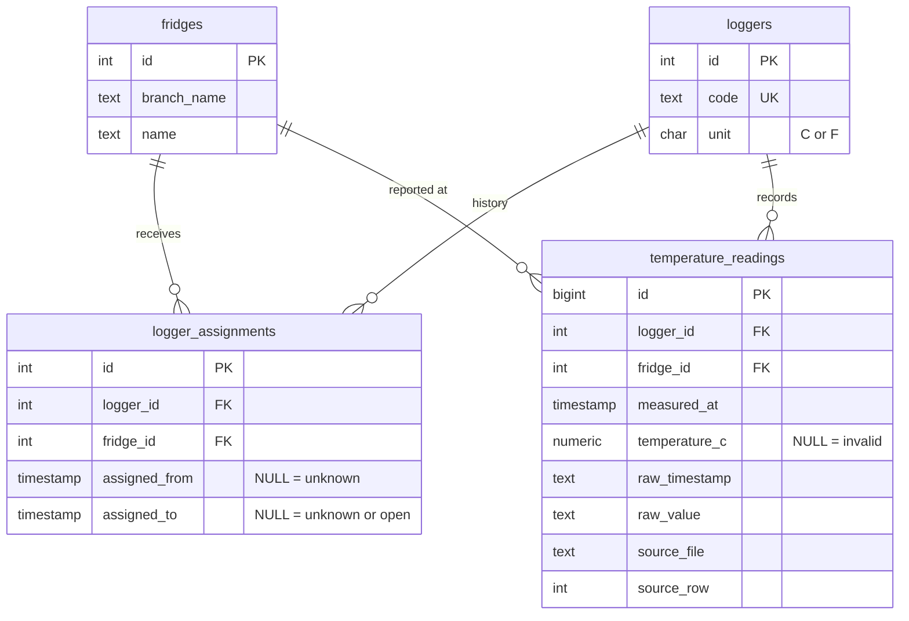

# Phase 2: Data Model and Initial Data Ingestion (revised)

## What I reviewed

- Backend: `app/database.py` has only `engine` (from `DATABASE_URL`) and `check_connection()`. `app/main.py` and `app/routers/health.py` are untouched by this plan.
- Tests: `tests/conftest.py` only provides a `TestClient`. There are 4 tests (2 unit, 2 `integration`).
- Infrastructure: `docker-compose.yml` bind-mounts `backend/app` and `backend/tests`. The Dockerfile copies `app`, `tests` and `pytest.ini`. Neither includes migrations or seed files yet.
- Sample file (`~/Downloads/fridge_temperature_logs.xlsx`): one sheet, columns `Logger | Branch | Fridge | Time | Temp`, 16 data rows. `Time` is stored as **text**, and `Temp` is a number except for one `ERR`.

## What the 16 rows prove (and what they do not)

- **Sites:** 4 loggers and 5 fridges. `Dairy` exists in both Jerusalem and Haifa, so a fridge is identified by branch plus name, not name alone.
- **Timestamps:** two text formats, `2026-09-14 06:00` and day-first `14/09/2026 06:00` (Haifa only).
- **Fahrenheit:** TL-0231 (Haifa) reports 38.3 and 39, which are about 3.50 and 3.89 C. The file has no unit column.
- **Bad and repeated rows:** one `ERR` (TL-0231, 06:30), one exact duplicate (TL-0512, 06:15, 3.9 twice), and one out-of-order row (TL-0417, 05:45).
- **Reassignment:** TL-0417 is reported at Tel Aviv/Walk-in from 2026-09-14 05:45 to 06:30, then at `tel aviv`/Display 2 on 2026-09-17 06:00. **The move happened sometime in between and the data does not say when.**
- **Warm reading:** TL-0417 at 9.4 C is a real value and is kept as is.
- **Partial sample:** these rows are only a slice of the real data, so nothing here is a complete history.

## Schema (exactly 4 tables)

There is no `branches` table: the branch is the `fridges.branch_name` column.

Constraints, all enforced in the database:

- `fridges`: unique on `(lower(branch_name), lower(name))` (functional unique index). Both columns are stored whitespace-trimmed and collapsed, keeping the first-seen spelling, so `tel aviv` resolves to `Tel Aviv`. `Dairy` can repeat across branches.
- `loggers`: `code` is unique, and `CHECK (unit IN ('C','F'))`.
- `logger_assignments`: `CHECK (assigned_from IS NULL OR assigned_to IS NULL OR assigned_to > assigned_from)`, and `UNIQUE NULLS NOT DISTINCT (logger_id, fridge_id, assigned_from)` (PostgreSQL 16) so re-seeding cannot duplicate a row.
- `temperature_readings`: `UNIQUE (logger_id, measured_at)` is the dedup guarantee. `fridge_id` is `NOT NULL`. `temperature_c` is nullable.

Design decisions:

- **Invalid readings are `temperature_c IS NULL`.** There is no status column. `raw_value` keeps the original text (`"ERR"`), which is the explanation. A blank, non-numeric, NaN or infinite value is invalid.
- **No arbitrary rejection thresholds.** No numeric range is enforced. 9.4 C, or any other numeric value, is stored as given, and plausibility is an analytics concern for a later phase. `temperature_c` is plain `NUMERIC`, rounded to 2 decimals in code, so no precision limit can reject a value.
- **Raw values are preserved.** `raw_timestamp` and `raw_value` hold the original cell text (`"14/09/2026 06:00"`, `"38.3"`, `"ERR"`), and `source_file` and `source_row` point back to the spreadsheet row. Names keep their first-seen spelling.
- **Historical fridge association lives on each reading.** `temperature_readings.fridge_id` records the fridge the reading was reported under, so a later reassignment never rewrites history.
- **Assignments are facts about a logger and fridge pairing, with optional bounds.** Dates are nullable and NULL means unknown. TL-0417 gets two rows (Walk-in, Display 2) with both dates NULL. The time a logger was seen at a fridge is derived from readings (`MIN/MAX(measured_at)` per logger and fridge), so the out-of-order 05:45 row needs no special handling.
- **Never infer unknown dates.** Neither the last Walk-in reading nor the first Display 2 reading is promoted to a boundary. The 09-14 06:30 to 09-17 06:00 gap stays unknown. Real dates can only come from an explicit input later.
- **Celsius is canonical, and the unit is per logger.** `loggers.unit` is seeded as `F` for TL-0231 through a documented constant in the seed, because the file has no unit column. This is a judgement from inspecting the data and is recorded in `NOTES.md`. The conversion is never guessed from the value.
- **Timestamps** are stored as naive local time (`TIMESTAMP`). The sample carries no timezone, so no DST handling is added.

## Fridge resolution: explicit confirmation when ambiguous

Every reading needs a `fridge_id`. `resolve_fridge(session, logger, measured_at, explicit_fridge=None)` in `ingest.py` follows these rules:

1. **The source names a fridge** (the sample does, in its Branch and Fridge columns). That is the explicit confirmation. The fridge is get-or-created and a `(logger, fridge)` assignment is ensured, with NULL dates if new. If an assignment for a *different* fridge has known dates that cover `measured_at`, the row is rejected as a conflict and reported, not silently overridden.
2. **No fridge named** (a future logger-only file): use the single assignment whose **known** `assigned_from` and `assigned_to` bounds contain `measured_at` (a NULL `assigned_to` counts as open-ended only when `assigned_from` is known).
3. **Anything else is ambiguous**: no assignment, several candidates, or only NULL-dated assignments. Ingestion raises `AmbiguousFridgeError` asking the caller to pass `fridge=` explicitly. Nothing is guessed, including from "the only assignment on record", because the sample is partial.

## Normalization, validation, dedup (`app/normalize.py`, pure functions)

- **Names:** trim and collapse whitespace; matching is case-insensitive.
- **Timestamps:** accept native Excel datetimes, `YYYY-MM-DD HH:MM[:SS]`, and `DD/MM/YYYY HH:MM[:SS]`. Slash dates are always day-first, as the sample shows (`14/09`). Explicit formats only, never a guessing parser. A row whose timestamp cannot be parsed has no key, so it is rejected and reported in the ingest result, not stored.
- **Temperatures:** parse to `Decimal`. If the logger's unit is `F`, convert with `(F - 32) * 5 / 9`, rounded half-up to 2 decimals (38.3 F gives 3.50, 39 F gives 3.89).
- **Deduplication:** `INSERT ... ON CONFLICT (logger_id, measured_at) DO NOTHING`. An exact repeat is skipped and counted. If a later row has the same key and a different value, the first row wins and the conflict is reported. Re-running the seed inserts nothing.
- **Result object:** `IngestResult(inserted, duplicates, conflicts, rejected)` with row numbers and reasons. A bad row never aborts the file.

## Migrations (Alembic)

- Add `alembic` and `openpyxl` to `backend/requirements.txt`. No pandas.
- Add `backend/alembic.ini` and `backend/migrations/` with an `env.py` that reads `DATABASE_URL` (and accepts an override for tests), and a hand-written revision `0001_initial_schema` with `upgrade` and `downgrade`. It is not autogenerated.
- Run `docker compose exec backend alembic upgrade head`. This is manual and documented, not run at container start, so `/health`, startup and the existing CMD stay unchanged.
- Alembic is the only schema creator, so tests exercise the real migration.

## Infrastructure changes (minimal)

- `backend/Dockerfile`: also copy `alembic.ini`, `migrations/` and `seed/`.
- `docker-compose.yml`: add one bind mount, `./backend/migrations:/app/migrations`, so new revisions created in the container appear on the host. No other service, port or healthcheck changes.
- `backend/seed/sample_records.xlsx`: a copy of the provided file, renamed to carry no company name.

## Code layout (`backend/app/`)

- `models.py`: SQLAlchemy 2.0 models for the four tables. Add `SessionLocal` to `database.py`, leaving `engine` and `check_connection()` unchanged.
- `normalize.py`: the pure functions above.
- `ingest.py`: `read_sample_xlsx(path)`, `resolve_fridge(...)` and `ingest_rows(session, rows, source_file)`. Services never `commit()`.
- `seed.py`: `python -m app.seed`. It reads `seed/sample_records.xlsx`, creates the loggers with the TL-0231 unit setting, calls `ingest_rows`, and commits once. It is idempotent and run manually.

## Implementation steps (tests written with each step)

1. **Tooling and fixtures.** Add the dependencies and the Dockerfile and compose changes. `conftest.py` creates a separate `<POSTGRES_DB>_test` database, runs `alembic upgrade head` once per session, and gives each test a session rolled back at the end (savepoint mode). Dev data is never touched. Acceptance: the existing 4 tests still pass.
2. `**normalize.py**` with `test_normalize.py` (no database).
3. **Migration and `models.py`** with `test_migrations.py` and `test_models.py`.
4. `**ingest.py**` with `test_ingest.py`.
5. **Seed** with `test_seed.py` and the renamed sample file.
6. **Docs.** Update `NOTES.md` (the decisions above, including unknown reassignment dates, explicit fridge confirmation, no rejection thresholds, and the TL-0231 unit assumption) and `README.md` (migrate, seed, run unit versus integration tests).

## Test plan

- `**test_normalize.py` (unit):**
  - Both timestamp formats, plus invalid and empty input.
  - `ERR`, blank and NaN parse as invalid, and extreme numeric values such as 150 or -80 are **not** rejected.
  - F to C: 32 gives 0.00, 212 gives 100.00, 38.3 gives 3.50, 39 gives 3.89.
  - Name normalization.
- `**test_migrations.py` (integration):** upgrade creates exactly the four tables (no `branches`) and their constraints, downgrade removes them, and upgrade again works.
- `**test_models.py` (integration):**
  - A duplicate `(logger_id, measured_at)` is rejected.
  - A duplicate logger code, an invalid unit and an invalid assignment range are rejected.
  - A duplicate assignment with NULL dates is rejected.
  - A reading without `fridge_id` is rejected, and `temperature_c` NULL is accepted.
  - `Dairy` can exist in two branches but not twice in one, even with different casing.
- `**test_ingest.py`:**
  - Unit tests on plain Python rows for validation and in-batch dedup.
  - Integration tests with a small xlsx built by `openpyxl`: a Fahrenheit logger is converted while raw text is preserved, `ERR` is stored with NULL `temperature_c` and raw `"ERR"`, an unparseable timestamp is rejected and reported, a conflicting duplicate keeps the first value, and re-ingesting the same file inserts 0 rows.
  - `resolve_fridge`: an explicit fridge is accepted. With no fridge and no assignment, with several assignments, or with only NULL-dated assignments, `AmbiguousFridgeError` is raised. A known-dated assignment resolves, and a conflicting explicit fridge is rejected and reported.
- `**test_seed.py` (integration):**
  - Counts: 5 fridges, 4 loggers, 5 assignments, 16 input rows, 15 unique readings, 14 with a value and 1 with NULL `temperature_c` (the `ERR` row). One duplicate is skipped and none are rejected.
  - TL-0231 readings are 3.50 and 3.89 C, with raw `38.3` and `39` preserved.
  - Branch casing drift is normalized: the Display 2 fridge (reported as `tel aviv`) is stored with `branch_name` `Tel Aviv`, the same spelling as the Walk-in fridge.
  - TL-0417 has two assignments, both with NULL `assigned_from` and `assigned_to`. Its readings at Walk-in span 05:45 to 06:30 on 2026-09-14, and its Display 2 reading is 2026-09-17 06:00, each with the matching `fridge_id`. No date for the move is stored.
  - A second seed run changes no counts.

## Verification

- `docker compose exec backend pytest` passes with a non-zero collected count. `pytest -m "not integration"` passes with `db` stopped.
- `alembic upgrade head`, then `python -m app.seed` twice, and the `psql` counts match both times (5 fridges, 4 loggers, 5 assignments, 15 readings).
- Spot-check in `psql`: the TL-0231 values, the two NULL-dated TL-0417 assignments, and the `ERR` row with NULL `temperature_c` and raw `ERR`.
- Data survives `docker compose down` and `up`. `/health` still returns 200.

## Out of scope

Analytics (excursion detection, thresholds, summaries), HTTP endpoints including file upload, UI, per-logger files without a fridge column beyond the `resolve_fridge` rules, timezones, authentication, and any date for the TL-0417 move.