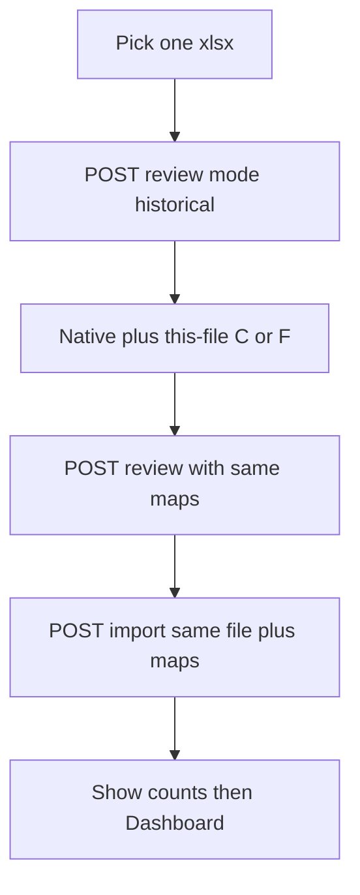
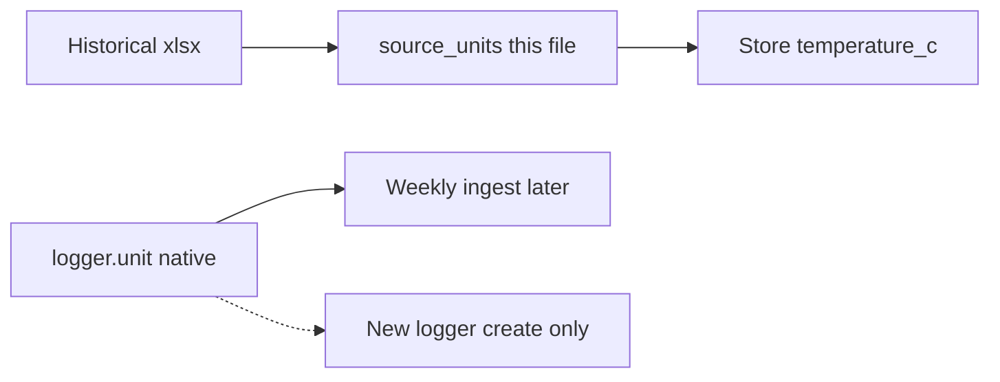

# Phase 4: Initial Setup (Historical Excel Import)

## Scope and prerequisite

Phase 3 already implemented `POST /api/uploads/review` and `/api/uploads/import` with `mode=historical` and `mode=weekly`. Weekly Upload exists in the UI and hardcodes `mode=weekly`. There is still no Initial Setup screen and no historical API client.

This phase:

- Adds the bakery-manager Initial Setup UI (one combined `.xlsx`).
- Adds unique `{branch, name}` fridge listing on the historical payload (review currently reports `fridges_created` counts, not names).
- Splits **file source unit** from **stored native unit** for historical conversion only.

Out of scope: fridge remapping, merge/edit of misspelled names, logger-unit edits after create, move recording, multi-file historical pick, weekly filename matching, schema/migration, data import as part of implementation, git commit/push.

## Existing capabilities to reuse

Backend: [`backend/app/upload.py`](../../backend/app/upload.py) (`process_historical`, `review_upload`, `import_upload`) and [`backend/app/routers/api.py`](../../backend/app/routers/api.py).

- `mode=historical`, **exactly one** `.xlsx` (max 5 MB). Combined columns: Logger, Branch, Fridge, Time, Temp (aliases in [`backend/app/ingest.py`](../../backend/app/ingest.py)).
- Review is a nested-transaction dry run (`dry_run: true`). Import is **one atomic commit**.
- Fridge mapping comes **from the sheet**. The API does not guess a fridge. Undated `(logger, fridge)` assignments are created; dated moves are not invented.
- Dedup on `(logger_id, measured_at)`: same value → duplicate; different value/fridge → conflict; first stored reading kept.
- Invalid/ERR rows reported; valid rows still import.

Native units for **new** loggers only (existing `Logger.unit` is never overwritten):

- `HISTORICAL_LOGGER_UNITS = {"TL-0231": "F"}`.
- Other new Haifa loggers: `source: unresolved` until `logger_units` supplies `C` or `F` (`blocked: true` on import).
- Other new loggers default to **C**.

Frontend already has Weekly Upload styling (`weekly`, `weekly-card`, `weekly-btn`, banners) and an empty-state prompt to run Initial Setup. [`frontend/src/api/upload.ts`](../../frontend/src/api/upload.ts) hardcodes `mode=weekly` and omits `logger_units`, `source_units`, and historical mode.

## Problem: conversion tied to native unit

Today [`ingest_rows`](../../backend/app/ingest.py) always converts with `to_celsius(raw, logger.unit)`. `logger_units` only sets **new** logger native units; existing units are ignored. That cannot express:

- Stored native: TL-0231 = **F** (for later weekly files).
- This historical Excel: values already **C**.
- Future weekly files: **F** again.

Choosing C via `logger_units` would store native C and skip conversion on later F weekly files. Leaving native F would double-convert an already-Celsius historical sheet.

## Backend change (smallest, no migration)

No schema/migration. Weekly path unchanged (`process_weekly` never receives source units).

Add Form field **`source_units`**: JSON `{logger_code: "C"|"F"}`, historical only. Reuse the same C/F parser as `parse_logger_units`. Default `{}`. Weekly requests ignore it.

Two maps:

| Field | Meaning | Who it applies to |
| --- | --- | --- |
| `logger_units` | Native device unit stored on `loggers.unit` | **New** loggers only. Existing units never overwritten. TL-0231 still defaults to F. Unresolved Haifa still blocks import until native C/F. |
| `source_units` | Unit of **this file’s numbers** | Conversion for this historical file only. Never written to `loggers.unit`. |

In `ingest_rows`, add optional `source_units`:

- Historical: `to_celsius(raw, source_unit)` for that logger.
- Weekly, or omitted source map: keep `to_celsius(raw, logger.unit)` (current behavior).

Header-stated temp unit (e.g. `Temp C`) is checked against the **conversion** unit (source unit when present, else native), not blindly against stored native. Otherwise `Temp C` + native F + source C would be a false error.

**Review and import use the same `process_historical` path** (nested rollback vs atomic commit). The same `source_units` + `logger_units` produce identical conversion.

**No guessing:** every logger appearing in the historical file must have an explicit `C` or `F` in `source_units`. Missing or invalid → review lists them; import `blocked: true` and writes nothing. Existing historical API tests that omit `source_units` must be updated to send it (typically matching the old native, e.g. TL-0231 `F`).

Do **not** send `logger_units.TL-0231=C` to “fix” an already-Celsius sheet. Native stays F; `source_units.TL-0231=C` converts this file without a second conversion.

## UI (keep it simple)

Reuse Weekly Upload layout (`weekly-*`). Do not parse Excel in the browser.

Flow: **Select file → Review mappings and units → Confirm → Import → Results.**

1. **Select** one `.xlsx`.
2. **Review** `POST /api/uploads/review` `mode=historical`:
   - Distinct `{branch, name}` pairs from parsed rows (no spelling merge or mapping editor).
   - Loggers from `logger_units` (code, branch, unit, source, is_new).
   - Counts: `historical.inserted`, `duplicates`, `conflicts`, `fridge_conflicts`, `rejected_total`, `invalid_values`, `loggers_created`, `fridges_created`, `assignments_created`.
   - Rejected (first 100 + total) and conflicts from `files[0]`.
   - **Native unit:** read-only when `source: known`; required C/F only for unresolved Haifa (`is_new`).
   - **This file unit:** C/F control for **every** logger in the file, including existing loggers.
   - Copy: native unit is for the device / later weekly files; this file’s unit is independent.
3. After every file logger has C/F (and Haifa native if needed), **re-review with the same maps** so preview counts match import. Import disabled until then, or while `blocked`/`invalid`/busy.
4. **Confirm** `POST /api/uploads/import` with the same `File`, `logger_units` (native for new/unresolved only), and `source_units` (all loggers). No auto-import.
5. **Result:** imported vs duplicates/conflicts/rejected; buttons to Dashboard and Weekly Upload. Mention once that a logger seen under several fridges stays ambiguous for weekly files until a move is recorded in Weekly Upload. No move UI here.

## Files expected to change

MUST:

- [`backend/app/ingest.py`](../../backend/app/ingest.py) — optional `source_units`; convert and header-check with that unit when set
- [`backend/app/upload.py`](../../backend/app/upload.py) — unique fridges on `historical`; require/apply `source_units` in `process_historical`; leave weekly alone
- [`backend/app/routers/api.py`](../../backend/app/routers/api.py) — Form `source_units` (default `{}`); pass through; weekly ignores
- [`backend/tests/test_api_upload.py`](../../backend/tests/test_api_upload.py), [`backend/tests/test_upload.py`](../../backend/tests/test_upload.py), [`backend/tests/test_ingest.py`](../../backend/tests/test_ingest.py)
- [`frontend/src/types/upload.ts`](../../frontend/src/types/upload.ts), [`frontend/src/api/upload.ts`](../../frontend/src/api/upload.ts)
- New [`frontend/src/components/InitialSetup.tsx`](../../frontend/src/components/InitialSetup.tsx) + [`frontend/src/components/InitialSetup.test.tsx`](../../frontend/src/components/InitialSetup.test.tsx)
- [`frontend/src/App.tsx`](../../frontend/src/App.tsx) — `initial-setup` page + nav
- [`frontend/src/components/WeeklyUpload.tsx`](../../frontend/src/components/WeeklyUpload.tsx) — empty-state “Initial Setup” opens the page
- [`frontend/src/App.css`](../../frontend/src/App.css) — only if a small `weekly-*` reuse tweak is needed

OPTIONAL: README “How to Use” / empty Dashboard copy that already mentions Initial Setup.

## Implementation steps

1. Unique `{branch, name}` list on historical JSON from already-parsed rows (first-seen spelling; no merge).
2. `source_units` through API → `process_historical` → `ingest_rows`. Gate historical ingest until every file logger has C/F. Do not change `Logger.unit` from source units.
3. Update historical tests; add the TL-0231 case (native F, file C, later weekly still F). Weekly tests unchanged.
4. Frontend types + historical FormData client (`mode=historical`, field `file`, `logger_units`, `source_units`). Keep weekly client unchanged.
5. `InitialSetup` phases: pick → review mappings/units → re-review → import result.
6. Wire App nav; Weekly Upload empty-state button opens Initial Setup (pass `onOpenInitialSetup` like `onOpenFridge`).
7. Focused frontend tests; full frontend suite + production build. No backend algorithm redesign beyond source units, no migrations, no data import, no commit/push.

## Tests and acceptance

### Backend

- Review fridge list is unique branch/name; still dry-run; import still atomic.
- Historical import without `source_units` (or missing a logger) is blocked; no rows written.
- Invalid unit (not C/F) rejected.
- **TL-0231 native F, historical `source_units` C:** e.g. `3.8` stored as `3.80`; `Logger.unit` remains `F`.
- Same logger, weekly Time/Temp with native F still converts F→C.
- Review and import with the same maps produce the same converted `temperature_c` (dry-run vs commit).
- Header `Temp C` + source C + native F is valid; header `Temp F` + source C is a file error.
- Existing logger: `logger_units` still cannot change stored unit; `source_units` still converts this file.

### Frontend (mock fetch)

- One `.xlsx` only; non-xlsx rejected in UI.
- Review sends `mode=historical` and does not persist (assert `dry_run` in mock body; no second write until import).
- Distinct branch/fridge names shown.
- Native read-only for known units; Haifa native required; **This file** C/F required for every logger including existing.
- Import sends `source_units` (not native) for the already-Celsius case; does not send TL-0231 native C.
- Import disabled until explicit Review + all file units (and Haifa native) confirmed.
- Result shows inserted / duplicates / conflicts / rejected.
- Nav: Dashboard from result; Weekly Upload banner opens Initial Setup.

### Acceptance

Empty DB → Initial Setup → confirm file units independently of native → import → Dashboard shows fridges. Repeat import of the same file reports duplicates, does not overwrite. Native F loggers still convert weekly F files. Never assign a fridge that was not in the file.

## Risks and limitations

- **Misspelled fridge names** cannot be remapped; the manager fixes Excel and re-imports (only new keys insert). Review fridge list is names as written, not a mapping editor.
- **Undated multi-fridge loggers** stay ambiguous for weekly files until a move is recorded in Weekly Upload. Mention once on the result screen; do not add move UI here.
- **Existing historical API callers** must start sending `source_units` (intentional; weekly callers unaffected).
- First review without `source_units` lists mappings and unit pickers; converted counts are only trustworthy after re-review with the confirmed maps.

## MUST vs OPTIONAL

MUST: `source_units` independent of native unit; identical review/import conversion; C/F validation (no guessing); fridge-name list on historical payload; historical client; Initial Setup page; import after confirm; result + Dashboard; tests; Weekly Upload link; weekly ingest unchanged; no migration.

OPTIONAL: README; grouping loggers by fridge; “download rejected rows”.
